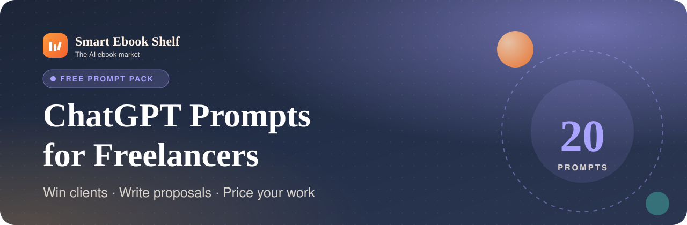

# 20 Free ChatGPT Prompts for Freelancers

**20 copy-paste prompts for ChatGPT, Claude and Gemini** that help freelancers find clients, write proposals, price their work, deliver faster and get paid. Works with the free versions.

Fill in the **[brackets]**, paste, and review the answer before you send anything.

> These prompts follow the method of **[Prompts That Ship](https://bestbookdotcom.gumroad.com/l/ai-side-income-playbook)**: 300 production-grade prompts, each with a role, a precise spec, constraints and its most common failure mode named in advance.

---

## Find your offer

**1. Skill-to-offer mapper**
> You are a freelance business coach. My skills: [LIST 3–5 SKILLS WITH PROOF]. Hours per week: [N]. Turn these into 5 specific freelance offers. For each: who buys it, the exact deliverable, a starting price with a reason, and where to find the first client. Cut any offer that needs an audience first.

**2. Niche picker**
> Compare these 3 niches for a freelance [SERVICE]: [NICHE A], [NICHE B], [NICHE C]. Score each from 1–10 on: how much clients pay, how easy they are to reach, how often they need the service, and competition. Recommend one and explain why in 3 sentences.

**3. Offer in one sentence**
> Write 10 one-sentence offers for my freelance service in this format: "I help [WHO] get [RESULT] in [TIME] without [PAIN]." My service: [SERVICE]. My ideal client: [CLIENT]. Avoid hype words like "ultimate" or "skyrocket".

## Win clients

**4. Upwork / Fiverr profile**
> Write my freelance profile for [PLATFORM]. Service: [SERVICE]. Ideal client: [CLIENT]. Proof: [PROJECTS, RESULTS OR SKILLS]. Start with the client's problem, not with "Hi, I'm". Keep it under 200 words, with a short bulleted list of what I deliver and a clear call to action.

**5. Job post proposal**
> Here is a job post: [PASTE JOB POST]. Write a proposal of 120–180 words. Open with the client's goal in their words, show you understood the hardest part of the job, give a 3-step plan, mention one relevant proof point ([PROOF]), and end with one question that invites a reply. No generic flattery.

**6. Cold outreach message**
> Write a short cold message (under 90 words) to [TYPE OF BUSINESS] offering [SERVICE]. Mention one specific thing I noticed about their business: [OBSERVATION]. Offer one small, free, useful idea. End with a low-pressure question. Friendly and human, no salesy phrases.

**7. Follow-up sequence**
> A potential client hasn't replied to my proposal for [PROJECT] sent [DAYS] days ago. Write 3 follow-up messages for day 3, day 7 and day 14. Each under 60 words, each adds something new (an idea, an example, a question). The last one politely closes the loop.

## Price and scope

**8. Pricing helper**
> Help me price [SERVICE] for [CLIENT TYPE]. My experience: [LEVEL]. Time per project: [HOURS]. Give 3 packages (basic, standard, premium) with what's included, the price and why. Show the hourly rate each package works out to.

**9. Scope of work**
> Turn this project request into a clear scope of work: [PASTE REQUEST]. Include deliverables with a definition of "done", number of revisions, what is NOT included, timeline with milestones, and what I need from the client.

**10. Scope creep reply**
> A client asked for extra work that isn't in our agreement: [REQUEST]. Our agreed scope: [SCOPE]. Write a friendly reply that values the idea, explains it's outside the scope, and offers it as an add-on for [PRICE] or in a next phase.

**11. Raise your rates**
> Write a polite message to my existing client [NAME] explaining that my rate for [SERVICE] will go from [OLD] to [NEW] starting [DATE]. Thank them, mention the value I've delivered ([RESULTS]), and offer to keep the old rate for [ONE MORE PROJECT/MONTH].

## Deliver faster

**12. Client brief questions**
> I'm starting a [TYPE OF PROJECT] for a client in [INDUSTRY]. Write the 10 most important questions to ask before I start, grouped into goals, audience, style, and practical details. Mark the 3 questions that most often prevent revisions later.

**13. First draft from notes**
> Turn these messy notes into a clean first draft of [DELIVERABLE: blog post / email / landing page / report] for [CLIENT]: [PASTE NOTES]. Audience: [AUDIENCE]. Tone: [TONE]. Mark any fact you're unsure about with [CHECK].

**14. Quality check**
> Act as a strict editor. Review this deliverable before I send it to the client: [PASTE WORK]. The brief was: [BRIEF]. List anything that misses the brief, unclear sentences, errors and weak spots, ordered by importance. Then give the 3 changes that would improve it most.

**15. Project update**
> Write a short project update for my client. Done this week: [DONE]. Next: [NEXT]. Blockers or things I need from them: [NEEDS]. Keep it under 120 words, clear and confident.

## Get paid and grow

**16. Late payment reminder**
> Write a polite but firm reminder for invoice [NUMBER] of [AMOUNT], due on [DATE], for [PROJECT]. Include the payment details placeholder and a clear new date. Keep the relationship friendly.

**17. Testimonial request**
> Write a short message asking [CLIENT] for an honest testimonial about [PROJECT]. Make it easy: give 3 optional questions they can answer. No pressure and no suggested wording for the review itself.

**18. Case study**
> Turn this finished project into a short portfolio case study: client type: [CLIENT], problem: [PROBLEM], what I did: [WORK], result: [REAL RESULT]. Structure: challenge, approach, result, what the client said (only if I provide a real quote). Under 250 words.

**19. Repeat work offer**
> My project [PROJECT] with [CLIENT] just ended well. Suggest 3 natural next projects or a monthly retainer I could offer them, with a short message that proposes the best one.

**20. Weekly freelance plan**
> I have [HOURS] hours this week. Active projects: [LIST WITH DEADLINES]. Lead generation goal: [GOAL]. Build a day-by-day plan that protects deep-work time, schedules outreach, and leaves a buffer for revisions.

---

## FAQ

### Can I use ChatGPT to write Upwork or Fiverr proposals?

Yes, as a first draft. Always add your real experience, check every detail and make it specific to the job. Generic AI proposals get ignored.

### Do these prompts work with the free version of ChatGPT?

Yes. They work with the free versions of ChatGPT, Claude and Gemini.

### How do I get better answers from these prompts?

Fill every [bracket] with specific details, add one example of work you like, and ask the AI to improve its answer once before you use it.

---

## More free AI resources

- **[Free Claude Skills: viral hooks, email replies and client proposals](https://github.com/smartebookshelf/free-claude-skills)**
- **[30 free AWS Cloud Practitioner (CLF-C02) practice questions + cheat sheet](https://github.com/smartebookshelf/aws-cloud-practitioner-practice-questions)**
- **[30 free AI video prompts for Veo, Sora, Kling and Runway](https://github.com/smartebookshelf/ai-video-prompts)**
- **[20 free AI prompts for teachers](https://github.com/smartebookshelf/ai-prompts-for-teachers)**
- **[20 free ChatGPT prompts to make money online](https://github.com/smartebookshelf/chatgpt-prompts-to-make-money)**
- **[2 free no-code AI agent templates](https://github.com/smartebookshelf/no-code-ai-agent-templates)**
- **[Which AI model should I use: ChatGPT vs Claude vs Gemini](https://github.com/smartebookshelf/which-ai-model-should-i-use)**
- **[All Smart Ebook Shelf books and free PDFs](https://bestbookdotcom.gumroad.com/)**

---

## Want 280 more?

**[Prompts That Ship](https://bestbookdotcom.gumroad.com/l/ai-side-income-playbook)** is a 140-page reference with **300 production-grade prompts** across 10 chapters: idea and validation, product and shipping, freelancing and contracts, content, social, email, copy, ads, store operations and systems. Plus a Quick Finder, a Red Team section and a 30-day plan.

👉 **[Get Prompts That Ship](https://bestbookdotcom.gumroad.com/l/ai-side-income-playbook)** · Free PDF: **[15 Money-Making AI Prompts](https://bestbookdotcom.gumroad.com/l/free-money-making-ai-prompts)**

---

⭐ If these prompts help you land a client, a star helps other freelancers find them.

*Free to use and share with credit. Independent resource by Smart Ebook Shelf. ChatGPT, Claude and Gemini are trademarks of their respective owners.*
